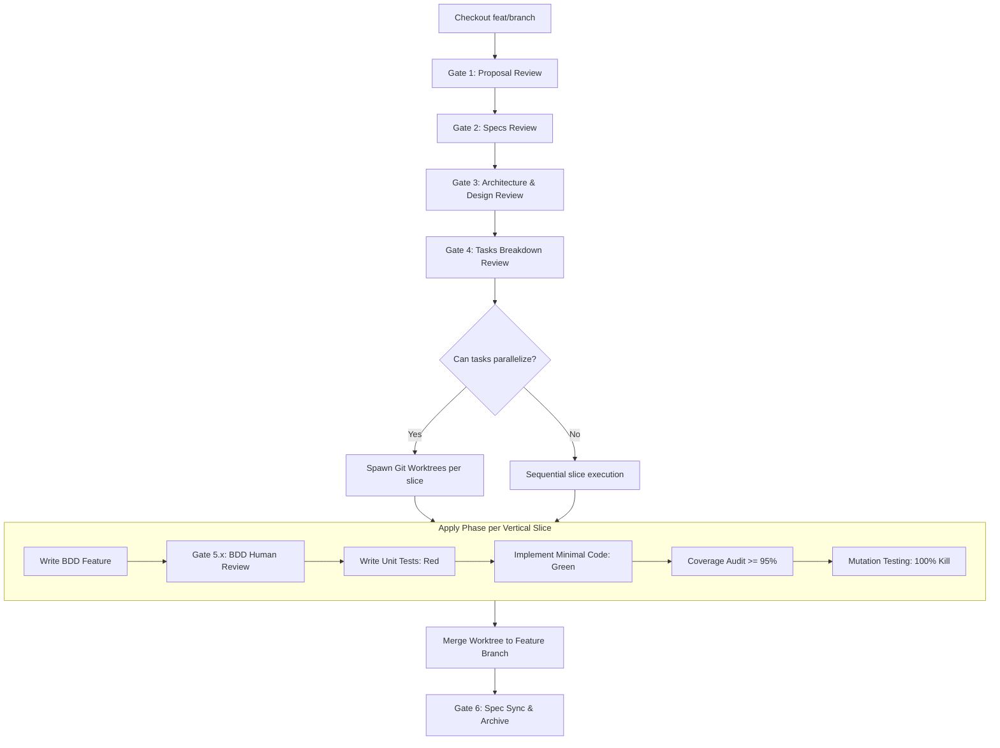

# STDD (Spec & Test-Driven Development) Workflow

## 1. Branching & Worktree Strategy

### Rule 1: Always Use a New Feature Branch
- **NEVER** work directly on `main` / `master`.
- Every OpenSpec change proposal MUST originate on a dedicated feature branch:
  ```bash
  rtk git checkout -b feat/<change-id>-<change-name>
  ```
- All proposal, specs, design, tasks, and vertical slice work commits to this feature branch.

### Rule 2: Parallelize via Git Worktrees
- When tasks/slices can be parallelized (or delegated across concurrent subagents):
  1. Add `.worktrees/` to `.gitignore`.
  2. Spawn an isolated worktree for the slice:
     ```bash
     rtk git worktree add .worktrees/<slice-name> -b feat/<change-id>/<slice-name>
     ```
  3. Run BDD, unit tests, code implementation, and mutation suites in the isolated worktree.
  4. On completion and review gate approval, merge the slice back into the feature branch:
     ```bash
     rtk git checkout feat/<change-id>-<change-name>
     rtk git merge --ff-only feat/<change-id>/<slice-name>
     rtk git worktree remove .worktrees/<slice-name>
     ```
- Coding subagents executing parallel tracks MUST use `Workspace: 'share'` or `'branch'` to maintain worktree isolation.

---

## 2. Workflow Lifecycle & Human Gates



### Gate 1: Proposal Review
- **Artifact**: `openspec/changes/<change>/proposal.md`
- **Mandatory Sections**: Intent, Scope (In/Out-of-scope), Success Metrics, Assumptions (`ASM-GEN-*`).
- **Gate**: Human approval required before drafting specs.

### Gate 2: Specifications Review
- **Artifacts**: `openspec/changes/<change>/specs/<capability>/spec.md`
- **Mandatory Sections**: Requirements (`REQ-*`), Assumptions (`ASM-*`), Edge Cases & Errors.
- **Traceability**: Every requirement MUST be uniquely keyed (`REQ-<DOMAIN>-<ID>`).
- **Gate**: Human approval required before technical design.

### Gate 3: Architecture & Design Review
- **Artifact**: `openspec/changes/<change>/design.md`
- **Mandatory Sections**: Architecture Diagrams, Domain Models & Protocols, Tech Stack, Boundary Rules, Assumptions.
- **ML/NLP Rule**: Tier 0 Dumb Baseline is mandatory before higher tiers.
- **Gate**: Human approval required before task breakdown.

### Gate 4: Tasks Breakdown Review
- **Artifact**: `openspec/changes/<change>/tasks.md`
- **Structure**: Granular vertical slices ordered by test-first dependencies with parallel worktree opportunities identified.
- **Gate**: Human approval required before writing test code.

---

## 3. Apply Phase: Vertical-Slice Test-Driven Implementation

For each functional component/slice:

### Step 5.x-A: BDD Behavior Scenarios (100% Behavior Coverage)
- Write Gherkin feature file (`tests/bdd/features/*.feature`) covering all requirements and boundary conditions.
- **Gate 5.x**: Human approval required before writing unit tests and implementation.

### Step 5.x-B: Unit Tests & Red-Green Implementation (>= 95% Coverage)
- **Red**: Write failing unit tests first in `tests/unit/test_*.py`. Verify test failure.
- **Green**: Implement minimal production code (`src/sentiments/*`) to make tests pass.
- **Refactor**: Clean code under green test protection.
- **Coverage**: Enforce line and branch coverage $\ge 95\%$ via `uv run pytest --cov=src/sentiments --cov-branch`.

### Step 5.x-C: Mutation Testing (100% Kill Score)
- Execute mutation testing (`uv run mutmut run`).
- **Surviving Mutant Protocol**: Any surviving mutant is a critical defect:
  1. Add a targeted test assertion killing the mutant, OR
  2. Delete redundant unneeded code (Ponytail / YAGNI rule).
- Target: 100% mutation kill rate on domain and core logic.

---

## 4. Coding Agents & LGTM Harness Integration

- **Anchor Directives**: Support line-anchored feedback directives (`#ref file:line <directive>`) from code review harnesses (`lgtm`).
- **Review Inbox**: Check `.lgtm/reviews/` and user directives on every turn; resolve inline review feedback before advancing.
- **Test Integrity (Anti-Fraud)**:
  - NEVER delete assertions or drop tests to force a green run.
  - NEVER use vacuous assertions (`assert True`) or silent mock overrides.
  - NEVER add `@pytest.mark.skip` / `xit` without explicit user sign-off.
- **Architecture Boundaries & Cleanliness**:
  - Domain core (`sentiments.core`) must have zero dependencies on I/O, network, or external APIs.
  - Blast radius: Keep file touches strictly localized to the active vertical slice.
  - Zero scratch pollution: No debug dumps, `.env` leaks, or untracked scratch scripts in repo.

---

## 5. Gate 6: Living Spec Sync & Archive

1. Run full test suite (`uv run pytest --cov`) and verify 100% pass + $\ge 95\%$ coverage.
2. Run full mutation suite (`uv run mutmut run`) and verify 100% kill score.
3. Merge worktrees into change feature branch.
4. Sync change delta specs into canonical living directory (`openspec/specs/`).
5. Update `openspec/changes/<change>/tasks.md` and archive completed change.
