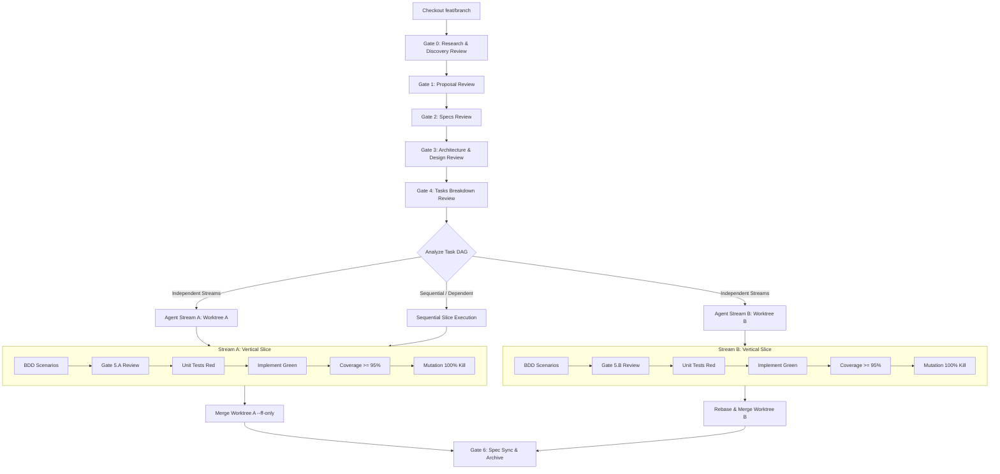
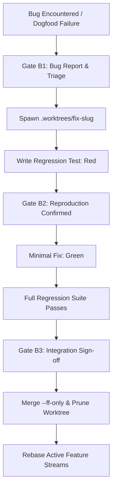

# Spec-Driven, Testing-Railed Development (SDTRD) Workflow

## 1. Branching & Worktree Strategy

### Rule 1: Always Use a New Feature Branch
- **NEVER** work directly on `main` / `master`.
- Every `specs/` feature proposal MUST originate on a dedicated feature branch:
  ```bash
  rtk git checkout -b feat/<feature-id>-<feature-name>
  ```
- All proposal, specs, design, tasks, and vertical-slice work commits to this feature branch.

### Rule 2: Multi-Agent Parallel Streams via Git Worktrees
- When tasks/slices have **no mutual dependencies** (orthogonal modules, distinct capabilities, or decoupled tests):
  1. **Pre-Requisite Contract Lock**: Any shared domain models, interfaces, or contracts (e.g. `core/models.py`) MUST be implemented, tested, and committed to the parent feature branch *before* spawning parallel worktrees.
  2. **Worktree Hygiene & Git Config Guard (`core.bare` Trap)**:
     - Ensure `.worktrees/` is present in root `.gitignore`.
     - Check for and clean any stale `.git/index.lock` prior to worktree operations:
       ```bash
       rtk rm -f .git/index.lock
       ```
     - **Shared Config Invariant**: Git commands inside worktrees MUST NEVER mutate shared repository config. Explicitly guard against worktree operations setting `bare = true` on the parent repository:
       ```bash
       rtk git config core.bare false
       ```
  3. **Spawn Isolated Worktree**:
     ```bash
     rtk git worktree add .worktrees/<feature-id>-<stream-name> -b feat/<feature-id>/<stream-name>
     ```
  4. **Environment & Path Resolution**:
     - Tests and modules MUST resolve repository and dataset roots dynamically (e.g. iterating `Path(__file__).parents` until root marker like `.git` or `pyproject.toml` is found).
     - Reuse parent virtual environment (`.venv`) inside the worktree without reinstallation.
  5. **Concurrently Dispatched Subagents & Human Gate Escalation**:
     - Dispatch a dedicated subagent (`invoke_subagent`) per stream, passing the worktree directory.
     - **Hard Prohibition**: Subagents **NEVER** self-approve human gates (Gates 1, 2, 3, 4, 5.x, 6, B1, B2) or jump ahead into coding autonomously.
     - **Main-Loop Escalation Protocol**: Upon completing any gate artifact, the subagent MUST pause, send a message to the Lead Orchestrator on the main loop, and halt execution.
     - **User Clearance**: Lead Orchestrator presents the clickable artifact link to the human user. Clearance is delivered back to the subagent only after explicit human approval in the main conversation.
     - Each agent executes its vertical slice in isolation:
       - BDD Scenarios (Gate 5.x escalation)
       - Unit Tests (Red)
       - Minimal Implementation (Green)
       - Coverage ($\ge 95\%$ line & branch)
       - Targeted Slice Mutation Testing ($100\%$ kill score on slice module)
  6. **Rebase & Merge Sequence**:
     - The first completed stream merges into the feature branch via fast-forward:
       ```bash
       rtk git checkout feat/<feature-id>-<feature-name>
       rtk git merge --ff-only feat/<feature-id>/<stream-name>
       rtk git worktree remove .worktrees/<feature-id>-<stream-name>
       rtk git branch -d feat/<feature-id>/<stream-name>
       ```
     - Subsequent streams MUST rebase onto the updated feature branch before merging:
       ```bash
       rtk git -C .worktrees/<feature-id>-<stream-2> rebase feat/<feature-id>-<feature-name>
       rtk git checkout feat/<feature-id>-<feature-name>
       rtk git merge --ff-only feat/<feature-id>/<stream-2>
       rtk git worktree remove .worktrees/<feature-id>-<stream-2>
       rtk git branch -d feat/<feature-id>/<stream-2>
       ```
  7. **Shared File Collision Protocol**:
     - When parallel streams touch shared dispatch, routing, or test harness files (e.g., CLI key event matchers, central enum routers, UI status bars, BDD runners):
     - Merge conflicts MUST be resolved **strictly additively**: combine registrations from both features, preserve handlers from both streams, and keep all test cases intact. NEVER overwrite or drop another stream's registrations or assertions.

### Rule 3: Fast-Track Bugfix Protocol (Zero-Contamination Bug Isolation)
- **Scope Distinction**:
  - **In-Flight Slice Defect**: A defect discovered inside the active slice being developed is resolved directly within that slice's branch/worktree via an immediate red-first regression test. No extra triage gates needed.
  - **Cross-Cutting / Main / Regression Defect**: A defect affecting already-merged modules or discovered during dogfooding MUST follow the full Fast-Track Protocol below.
- **HARD PROHIBITION**: NEVER modify production code on `main` or within a dirty feature working directory without an isolated worktree and red test.
- **Protocol Steps**:
  1. **Log Defect**: File a bug report in `specs/bug-reports/<date>-<slug>.md` detailing root cause, reproduction steps, and expected behavior.
  2. **Spawn Worktree**: Create an isolated bugfix worktree branching off target base (e.g., `main`):
     ```bash
     rtk git worktree add .worktrees/fix-<bug-slug> -b fix/<bug-slug> main
     ```
  3. **Mandatory Red-First Regression Test**:
     - Write a targeted test replicating the defect *before touching any production code*.
     - Run the test in the worktree: MUST fail (`Red`).
  4. **Minimal Fix (Green)**:
     - Apply the minimal surgical fix in the worktree to turn the test passing (`Green`).
     - Run the full test suite to guarantee zero regressions.
  5. **Merge & Prune**:
     - Fast-forward merge the fix into `main`:
       ```bash
       rtk git checkout main
       rtk git merge --ff-only fix/<bug-slug>
       rtk git worktree remove .worktrees/fix-<bug-slug>
       rtk git branch -d fix/<bug-slug>
       ```
  6. **Rebase Active Feature Branches**:
     - Rebase active feature branches and worktrees onto updated `main`.

### Rule 4: Mandatory Pre-Commit Hooks & Verification
- **Always Install Pre-Commit Hooks**:
  - Every project MUST configure and install pre-commit hooks (`pre-commit install` or repo hooks).
  - Pre-commit configuration lives in `.pre-commit-config.yaml`.
- **Pre-Commit Verification Protocol**:
  - Before staging and committing ANY changes:
    1. Inspect status and diff: `rtk git status` and `rtk git diff`.
    2. Run all linters and formatters (e.g., `pre-commit run --all-files` or project equivalent).
    3. Run all unit and integration tests.
  - **Zero-Bypass Prohibition**: Bypassing hooks via `git commit --no-verify` or `-n` is strictly forbidden. If a check or test fails, fix the code/test before committing.

---

## 2. Feature Lifecycle & Human Gates

### Canonical Directory Layout
```
specs/
├── WORKFLOW.md
├── features/       <-- Active in-progress feature development (proposals, designs, tasks, specs)
├── living/         <-- Canonical living specifications of shipped capabilities
├── archive/        <-- Archived lifecycle artifacts (proposals, designs, tasks of merged features)
└── bug-reports/    <-- Documented defect triage reports
```



### Gate 0: Research & Discovery Review
- **Mandatory Requirement**: Every feature MUST conduct empirical research and investigate technical trade-offs *before committing to building the feature* or locking in proposals and architectural designs.
- **Artifact**: `specs/features/<feature>/research.md`
- **Mandatory Sections**:
  - **Intent & Research Goals**: Core questions and feasibility risks to resolve.
  - **Prior Art & Ecosystem Survey**: Analysis of existing libraries, models, papers, or internal tools (reusable vs build).
  - **Empirical Spikes & Feasibility**: Micro-benchmarks, latency measurements, memory usage, pricing models, or API rate limits.
  - **Dataset & Input Nuances**: Inspection of real-world datasets, class distributions, noise, and edge cases.
  - **Alternatives Considered & Trade-Offs**: Comparative trade-off matrix of at least 2–3 candidate approaches.
  - **Risks & Mitigations**: Identified failure modes and architectural bottlenecks.
- **Gate**: Human approval required before drafting proposal and specifications.

### Gate 1: Proposal Review
- **Artifact**: `specs/features/<feature>/proposal.md`
- **Mandatory Sections**: Intent, Problem Statement, Scope (In-Scope / Out-of-Scope YAGNI), Success Metrics, Assumptions (`ASM-GEN-*`).
- **Gate**: Human approval required before drafting specs.

### Gate 2: Specifications Review
- **Artifacts**: `specs/features/<feature>/specs/<capability>/spec.md`
- **Mandatory Sections**: Functional Requirements (`REQ-*`), Non-Functional Requirements & Performance Budgets (`NFR-*`), Assumptions (`ASM-*`), Edge Cases & Error Conditions, Behavioral Scenarios (`Given / When / Then`).
- **Traceability**: Every requirement MUST be uniquely keyed (`REQ-<DOMAIN>-<ID>`, `NFR-<DOMAIN>-<ID>`).
- **Gate**: Human approval required before technical design.

### Gate 3: Architecture & Design Review
- **Artifact**: `specs/features/<feature>/design.md`
- **Mandatory Sections**:
  - Architectural Overview & Invariants
  - Domain Models, State & Interface Contracts
  - Architecture Diagrams & Data Flow
  - Boundary Rules (Pure Core vs I/O Shell)
  - Concurrency, Latency & Resource Budgets (matching `NFR-*` specs)
  - Testing Strategy
- **Domain-Specific Baselines**:
  - **UI / Interactive Systems**: Define render frame deadlines (e.g., $< 16\text{ms}$), input latency budgets, and background I/O offloading rules.
  - **ML / Data / Heuristics**: Mandate a deterministic Tier 0 Dumb Baseline before complex models or external APIs.
- **Gate**: Human approval required before task breakdown.

### Gate 4: Tasks Breakdown Review
- **Artifact**: `specs/features/<feature>/tasks.md`
- **Mandatory Sections**:
  - **Dependency DAG**: Explicit mapping of slice prerequisites.
  - **Multi-Agent Streams**: Orthogonal slices partitioned into streams (`Stream A`, `Stream B`, etc.) with designated Git worktrees (`.worktrees/<feature>-<stream>`).
  - **Order of Execution**: Test-first vertical slice steps per stream (BDD $\rightarrow$ Gate 5.x $\rightarrow$ Unit Red $\rightarrow$ Code Green $\rightarrow$ Coverage $\rightarrow$ Mutation).
  - **Integration & Rebase Plan**: Merge sequence and synchronization checkpoints across streams.
- **Gate**: Human approval required before spawning worktrees or writing test code.

---

## 3. Bug Lifecycle & Fast-Track Gates



### Gate B1: Bug Report & Triage
- **Artifact**: `specs/bug-reports/<date>-<slug>.md`
- **Mandatory Sections**: Status & Metadata, Summary, Steps to Reproduce, Expected vs Actual Result, Root Cause Analysis, Remediation Plan.
- **Gate**: Human approval required before code execution.

### Gate B2: Reproduction Confirmed (Red-First)
- Spawn isolated worktree off target branch (`rtk git worktree add .worktrees/fix-<slug> -b fix/<slug> main`).
- Write targeted regression test replicating the defect *before touching any production code*.
- Test MUST fail (`Red`) on unmodified code.
- **Gate**: Human verifies the failing test reproduces the real defect.

### Gate B3: Integration Sign-off
- Apply minimal surgical fix (`Green`) and run full regression suite.
- Human inspects final diff and test output.
- Fast-forward merge into `main`, prune worktree, mark bug report `Resolved` with commit hash, and rebase active feature branches.

---

## 4. Apply Phase: Vertical-Slice Test-Driven Implementation

Execute each vertical slice through three strict sub-steps:

### Step 5.x-A: BDD Behavior Scenarios (100% Behavior Coverage)
- Write Gherkin feature scenarios (`tests/bdd/features/*.feature` or stack equivalent) covering all `REQ-*`, `NFR-*`, and boundary conditions.
- **Gate 5.x Presentation**: Present scenarios to human in ultra-compact bullet format (scenario title, key assertions, boundary checks). Wait for explicit confirmation before writing tests.

### Step 5.x-B: Unit Tests & Red-Green-Refactor ($\ge 95\%$ Coverage)
- **Red**: Write failing unit tests first. Verify test failure for the expected reason.
- **Green**: Implement minimal production code to make tests pass (strictly YAGNI).
- **Refactor**: Clean up duplication and structure under green test protection.
- **Coverage**: Enforce line and branch coverage $\ge 95\%$ on the target module.
- **Performance Verification**: Verify any `NFR-*` latency or allocation budgets with deterministic benchmarks/assertions.

### Step 5.x-C: Mutation Testing (100% Kill Score)
- **Scoped Run**: Scope mutation runner strictly to the active slice module (e.g., `mutmut run --paths-to-mutate src/<slice>/`) to avoid re-mutating completed slices. Full codebase mutation run is reserved for Gate 6.
- **Surviving Mutant Protocol**: Every surviving mutant is a blocking defect. Resolve by:
  1. Adding a targeted test assertion that kills the mutant, OR
  2. Deleting redundant/unreachable code (Ponytail / YAGNI rule).
- **Target**: $100\%$ mutation kill rate on slice domain and core logic.

---

## 5. Coding Agents & Review Harness Integration

SDTRD integrates natively with [mgabs/lgtm](https://github.com/mgabs/lgtm) as the real-time code review cockpit and agent steering harness:

- **Anchor Directives**: Honor line-anchored feedback directives (`#ref file:line <directive>`) emitted by `lgtm`. Acknowledge directive, resolve at exact target line, verify test pass, and commit.
- **Review Inbox**: Check `.lgtm/reviews/` and inline user directives on every turn; resolve review items before advancing gates.
- **Pre-Commit Verification**: Run all linters, formatting checks, and test suites prior to committing. Never bypass hooks with `--no-verify`.
- **Test Integrity (Anti-Fraud Guardrails)**:
  - NEVER delete assertions or weaken tests to force a green suite (`lgtm` test neutering guard will block review).
  - NEVER write vacuous assertions or tautological mocks.
  - NEVER skip/ignore failing tests without explicit human sign-off.
- **Architecture Boundaries & Hygiene**:
  - Keep domain core pure (zero direct I/O, network, or framework coupling).
  - Restrict file modifications strictly to the active vertical slice (minimal blast radius).
  - YAGNI enforcement: Zero dead unreferenced code added.
  - Leave zero scratch files, debug dumps, or `.env` artifacts in the working tree.

---

## 6. Gate 6: Living Spec Sync, Archive & Merge

1. Run the full test suite and verify $100\%$ pass rate + $\ge 95\%$ line and branch coverage.
2. Run the full mutation suite across the entire project and verify $100\%$ kill score on core logic.
3. Ensure all parallel stream worktrees are merged (`--ff-only`) into the feature branch and pruned.
4. Sync feature delta specs (`specs/features/<feature>/specs/`) into the canonical living specifications directory (`specs/living/`).
5. Check off all items in `specs/features/<feature>/tasks.md` and record Gate 6 completion.
6. Archive feature proposal and tasks to `specs/archive/<feature>/`.
7. Fast-forward merge feature branch into `main`:
   ```bash
   rtk git checkout main
   rtk git merge --ff-only feat/<feature-id>-<feature-name>
   ```
