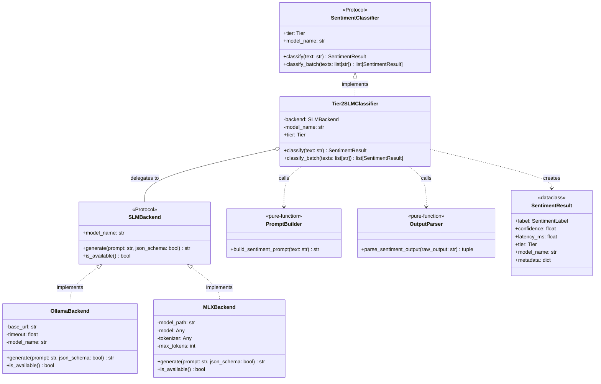
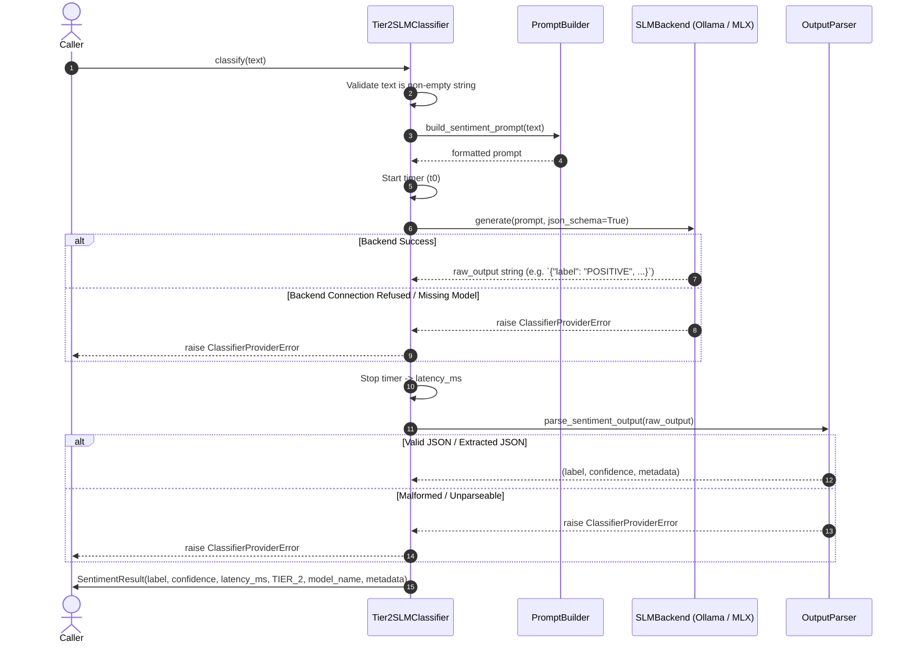

# Technical Design: Tier 2 Local SLM Classifier (Ollama & MLX)

## 1. Architectural Overview & Invariants

This design establishes the Tier 2 local Small Language Model (SLM) classification subsystem for `sentiments`. It delivers zero-cloud-fee, low-latency sentiment classification on developer laptops and Apple Silicon workstations running compact 1.5B–3B parameter models (`llama3.2:3b`, `qwen2.5:3b`).

### Hexagonal Architecture (Ports & Adapters)
The architecture strictly enforces separation between pure domain logic and external I/O execution:

```
+-----------------------------------------------------------------------------------+
|                                     I/O SHELL                                     |
|                                                                                   |
|  +---------------------------+             +-----------------------------------+  |
|  |       OllamaBackend       |             |            MLXBackend             |  |
|  | (Local HTTP / localhost)  |             |  (Apple Silicon Metal In-Process) |  |
|  +-------------+-------------+             +-----------------+-----------------+  |
|                \                                            /                     |
|                 +------------------+  +--------------------+                      |
|                                    |  |                                           |
|                                    v  v                                           |
|                       +-----------------------------+                             |
|                       |     SLMBackend Protocol     |                             |
|                       +--------------+--------------+                             |
|                                      |                                            |
|  +-----------------------------------|-----------------------------------------+  |
|  | PURE DOMAIN CORE                  v                                         |  |
|  |                    +------------------------------+                         |  |
|  |                    |      Tier2SLMClassifier      |                         |  |
|  |                    | (SentimentClassifier Protocol)                         |  |
|  |                    +-------+--------------+-------+                         |  |
|  |                            |              |                                 |  |
|  |                            v              v                                 |  |
|  |                   +----------------+  +-----------------+                   |  |
|  |                   | PromptBuilder  |  |  OutputParser   |                   |  |
|  |                   +----------------+  +-----------------+                   |  |
|  |                                                                             |  |
|  +-----------------------------------------------------------------------------+  |
+-----------------------------------------------------------------------------------+
```

### Core Invariants
1. **Zero External HTTP Dependencies**: `OllamaBackend` uses Python standard library `urllib.request`. No `requests`, `httpx`, or third-party HTTP libraries allowed.
2. **Platform & Hardware Isolation**: `MLXBackend` isolates `mlx-lm` and Apple Metal dependencies via dynamic imports. Non-macOS or x86 systems safely initialize and report `is_available() -> False` without crashing the package import graph.
3. **Purity of Domain Core**: Prompt formatting, JSON extraction, regex stripping, label mapping, and confidence clamping are pure, deterministic functions with zero network, filesystem, or OS calls.
4. **Frozen Immutability**: All classification outputs map into immutable `SentimentResult` frozen dataclasses.
5. **Fail-Fast Input Validation**: Empty or whitespace-only inputs are rejected at the classifier perimeter before any backend invocation.

---

## 2. Component Design & Contracts

### 2.1 Pure Domain Core

#### Prompt Construction (`build_sentiment_prompt`)
The prompt builder transforms raw customer review text into an instruction prompt with explicit JSON schema requirements:

```python
def build_sentiment_prompt(text: str) -> str:
    """Construct a deterministic prompt enforcing strict JSON schema output."""
    return (
        "You are an expert sentiment classification engine. "
        "Analyze the customer review below and classify its sentiment as exactly one of: "
        "POSITIVE, NEGATIVE, or NEUTRAL.\n\n"
        "Output ONLY a valid JSON object with exact keys:\n"
        "{\n"
        '  "label": "POSITIVE" | "NEGATIVE" | "NEUTRAL",\n'
        '  "confidence": <float between 0.0 and 1.0>,\n'
        '  "explanation": "<concise reason>"\n'
        "}\n\n"
        f"Review:\n\"\"\"{text}\"\"\"\n\n"
        "JSON:"
    )
```

#### JSON Sanitization & Parsing (`parse_sentiment_output`)
Model outputs frequently contain leading conversational phrases or Markdown code blocks (````json ... ````). The pure output parser guarantees deterministic extraction:

```python
import json
import re
from sentiments.core.models import SentimentLabel
from sentiments.providers.base import ClassifierProviderError

def parse_sentiment_output(raw_output: str) -> tuple[SentimentLabel, float, dict[str, str]]:
    """Extract and validate sentiment label, confidence, and metadata from raw LLM text."""
    clean = raw_output.strip()

    # Strip markdown fences
    if clean.startswith("```"):
        clean = re.sub(r"^```(?:json)?\s*", "", clean, flags=re.IGNORECASE)
        clean = re.sub(r"\s*```$", "", clean)
        clean = clean.strip()

    # Regex fallback to locate first valid JSON object
    match = re.search(r"\{.*?\}", clean, re.DOTALL)
    if not match:
        raise ClassifierProviderError(f"Malformed output: no JSON object found in: {raw_output[:100]}")

    try:
        data = json.loads(match.group(0))
    except json.JSONDecodeError as exc:
        raise ClassifierProviderError(f"Malformed JSON in response: {exc}") from exc

    raw_label = str(data.get("label", "")).strip().upper()
    try:
        label = SentimentLabel(raw_label)
    except ValueError:
        raise ClassifierProviderError(f"Invalid sentiment label returned: '{raw_label}'")

    # Clamping confidence between 0.0 and 1.0; default to 1.0 if omitted
    raw_conf = data.get("confidence", 1.0)
    try:
        confidence = float(raw_conf)
    except (TypeError, ValueError):
        confidence = 1.0
    confidence = max(0.0, min(1.0, confidence))

    metadata = {}
    if "explanation" in data and isinstance(data["explanation"], str):
        metadata["explanation"] = data["explanation"]

    return label, confidence, metadata
```

### 2.2 I/O Shell & Backend Interface

#### Abstract Backend Protocol (`SLMBackend`)
```python
from typing import Protocol, runtime_checkable

@runtime_checkable
class SLMBackend(Protocol):
    @property
    def model_name(self) -> str:
        """Model identifier (e.g. llama3.2:3b, qwen2.5:3b)."""
        ...

    def generate(self, prompt: str, json_schema: bool = True) -> str:
        """Generate raw completion text from model given prompt."""
        ...

    def is_available(self) -> bool:
        """Verify backend service/library availability."""
        ...
```

#### `OllamaBackend` (Standard Library HTTP Client)
- Communicates with Ollama daemon REST API (`http://localhost:11434/api/generate`).
- Uses `urllib.request.Request` and `urllib.request.urlopen` with configurable timeout (default 30.0s).
- Enforces `format="json"` in request payload to activate Ollama grammar-based JSON sampling.
- Diagnostic error handling:
  - `urllib.error.URLError` (Connection Refused): Raises `ClassifierProviderError("Ollama daemon unreachable at http://localhost:11434. Run 'ollama serve'.")`.
  - HTTP 404 (Model Not Found): Raises `ClassifierProviderError("Model '<model>' not found. Run 'ollama pull <model>'.")`.

#### `MLXBackend` (Apple Silicon Metal Inference)
- In-process execution via `mlx-lm`.
- Dynamic import inside `__init__` and `is_available()`. Catches `ImportError` gracefully.
- Checks platform: `sys.platform == "darwin"` and `platform.machine() in ("arm64", "aarch64")`.
- Caches loaded model and tokenizer instances in memory across requests.
- Executes `mlx_lm.generate(model, tokenizer, prompt, max_tokens=128, temp=0.0)`.

### 2.3 Unified Classifier (`Tier2SLMClassifier`)
Implements `sentiments.core.classifier.SentimentClassifier`:
- `tier`: Returns `Tier.TIER_2` (REQ-SLM-1).
- `model_name`: Delegated to `backend.model_name`.
- `classify(text: str) -> SentimentResult`:
  1. Validates input text: `if not isinstance(text, str) or not text.strip(): raise ValueError("text must be a non-empty string")`.
  2. Builds prompt via `build_sentiment_prompt(text)`.
  3. Measures elapsed time around `backend.generate(prompt)`.
  4. Parses raw output via `parse_sentiment_output(raw_str)`.
  5. Instantiates and returns frozen `SentimentResult`.
- `classify_batch(texts: list[str]) -> list[SentimentResult]`: Sequentially executes `classify` across inputs, capturing per-sample latencies.

---

## 3. Architecture & Data Flow Diagrams

### 3.1 Class & Contract Structure



### 3.2 Single Classification Execution Flow



---

## 4. Boundary Rules & Architectural Invariants

### 4.1 Dependency Inversion & Isolation
1. **Core Zero-I/O Rule**: The pure domain functions (`build_sentiment_prompt`, `parse_sentiment_output`) MUST NOT import any networking, file system, or machine learning libraries. Standard library `re` and `json` only.
2. **Backend Independence**: Backends depend on domain contracts, never vice versa. Adding a new inference backend (e.g., `LlamaCppBackend`) requires zero changes to the core prompt or parsing logic.
3. **Dynamic Metal Integration**: `MLXBackend` is conditionally imported at runtime. The top-level `sentiments` package can be imported on Linux CI environments without `mlx` or `mlx-lm` installed.

### 4.2 Data Sanitization & Input Rules
1. **Empty / Whitespace Check**: `text.strip() == ""` raises `ValueError` immediately, protecting the model from unbounded empty generations.
2. **Label Coercion**: Output string is uppercased and trimmed before matching `SentimentLabel`. If the output is `"positive"`, it maps to `SentimentLabel.POSITIVE`. Any unsupported string (e.g. `"MIXED"`, `"UNKNOWN"`) raises `ClassifierProviderError`.
3. **Confidence Bounds**: Any value outside `[0.0, 1.0]` is clamped to the boundary:
   $$\text{confidence} = \min(1.0, \max(0.0, c))$$
   If confidence is missing from model payload, it defaults to `1.0`.

---

## 5. Concurrency, Latency & Resource Budgets

### 5.1 Concurrency Model
- **Ollama**: Multi-threaded safe. Ollama runs as a standalone daemon managing its own HTTP worker queue and KV cache. The Python client opens a stateless HTTP connection per request.
- **MLX**: Single-process Metal compute. Inference operations hold Python GIL and Metal command buffers. Batch evaluation is sequentially dispatched.

### 5.2 Latency Budgets (Targeting NFR-SLM-1)
Target: P50 latency $\le 100\text{ms}$ on Apple Silicon (M-series) for models $\le 3\text{B}$.

| Pipeline Phase | MLXBackend Budget | OllamaBackend Budget | Implementation Guarantee |
| :--- | :--- | :--- | :--- |
| **Input Validation & Prompt Prep** | $< 0.1\text{ms}$ | $< 0.1\text{ms}$ | Pure string formatting |
| **Transport / IPC Overhead** | $0.0\text{ms}$ (in-process) | $6.0\text{–}12.0\text{ms}$ (loopback TCP) | Standard library `urllib` keep-alive |
| **Model Forward Pass (Prefill + Gen)** | $30.0\text{–}65.0\text{ms}$ | $45.0\text{–}80.0\text{ms}$ | 4-bit affine quantization, `max_tokens=32` |
| **Response Extraction & JSON Parse** | $< 0.5\text{ms}$ | $< 0.5\text{ms}$ | Regex + `json.loads` |
| **Total P50 Latency** | **$\approx 45\text{ms}$** | **$\approx 70\text{ms}$** | **Well within $100\text{ms}$ budget** |

### 5.3 Memory Budgets (Targeting NFR-SLM-3)
Target: Peak memory footprint $\le 3.5\text{GB}$ RAM for 4-bit 3B models.
- `Llama-3.2-3B-Instruct-4bit`: Model weight size $\approx 1.8\text{GB}$; KV cache + working memory $\approx 0.5\text{GB}$. Peak footprint $\approx 2.3\text{GB}$.
- `Qwen2.5-3B-Instruct-4bit`: Model weight size $\approx 1.9\text{GB}$; peak footprint $\approx 2.4\text{GB}$.

---

## 6. Testing Strategy & Quality Gates

In alignment with the test-driven lifecycle (`specs/WORKFLOW.md`), testing is structured across three rigorous layers:
1. **BDD Scenarios** (`tests/bdd/features/tier2_slm.feature`): Validates Scenarios 1–4 from `spec.md`.
2. **Isolated Unit Test Matrix** (`tests/unit/test_tier2_slm.py`):
   - Pure domain core tests (prompt, markdown parsing, confidence clamping, label error handling).
   - Mocked I/O tests (`OllamaBackend` with mocked `urllib`, `MLXBackend` with mocked `mlx_lm`).
   - Contract compliance tests for `Tier2SLMClassifier`.
3. **Mutation Testing**: $100\%$ mutant kill rate via `mutmut` on pure core prompt & parser modules.
4. **Coverage**: $\ge 95\%$ line & branch coverage.
