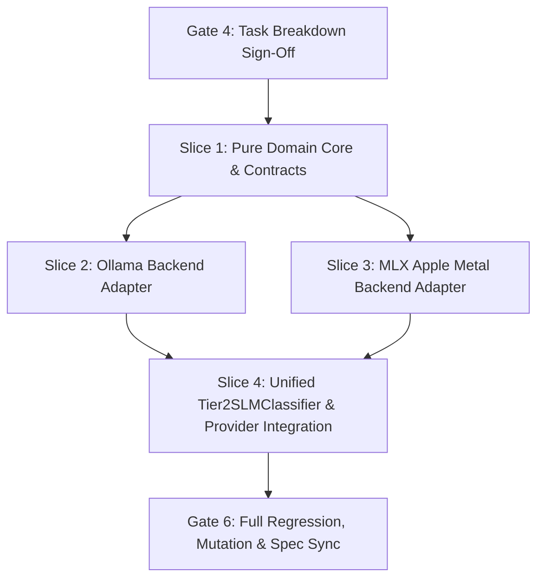

# Task Breakdown: Tier 2 Local SLM Classifier (Ollama & MLX)

## 1. Dependency DAG & Execution Overview



---

## 2. Vertical Slices & Detailed Steps

### Slice 1: Pure Domain Core & Parser (PromptBuilder & OutputParser)
*Scope*: Pure string/JSON manipulation with zero I/O or network dependencies.
- [x] **Step 1.A (BDD)**: Draft BDD scenarios for prompt generation, strict JSON parsing, markdown fence stripping (````json ... ````), label validation against `SentimentLabel`, and confidence clamping $[0.0, 1.0]$.
  - Escalation: Gate 5.1 Sign-Off.
- [x] **Step 1.B (Red Unit Tests)**: Write unit tests in `tests/unit/test_tier2_core.py`:
  - `test_build_sentiment_prompt_content()`
  - `test_parse_sentiment_output_clean()`
  - `test_parse_sentiment_output_markdown_fences()`
  - `test_parse_sentiment_output_embedded_json()`
  - `test_parse_sentiment_output_invalid_label_raises()`
  - `test_parse_sentiment_output_confidence_bounds()`
- [x] **Step 1.C (Green Code)**: Implement `build_sentiment_prompt` and `parse_sentiment_output` in `src/sentiments/providers/tier2/core.py`.
- [x] **Step 1.D (Coverage & Mutation)**: Verify $\ge 95\%$ coverage and $100\%$ mutant kill rate via `mutmut` on `tier2/core.py`.

---

### Slice 2: Ollama Backend Adapter (`OllamaBackend`)
*Scope*: Standard library HTTP client communicating with `localhost:11434`.
- [x] **Step 2.A (BDD)**: Draft BDD scenarios for successful HTTP generation, JSON format parameter enforcement, connection failure diagnostics, and 404 model not found handling.
  - Escalation: Gate 5.2 Sign-Off.
- [x] **Step 2.B (Red Unit Tests)**: Write unit tests in `tests/unit/test_tier2_ollama.py`:
  - Mock `urllib.request.urlopen` for happy path response generation.
  - Mock `URLError` for daemon offline diagnosis.
  - Mock `HTTPError(404)` for missing model message.
- [x] **Step 2.C (Green Code)**: Implement `SLMBackend` protocol and `OllamaBackend` in `src/sentiments/providers/tier2/ollama.py`.
- [x] **Step 2.D (Coverage & Mutation)**: Verify $\ge 95\%$ coverage and kill all mutants.

---

### Slice 3: MLX Apple Silicon Backend Adapter (`MLXBackend`)
*Scope*: In-process Metal acceleration via dynamic `mlx-lm` import.
- [x] **Step 3.A (BDD)**: Draft BDD scenarios for in-process inference generation, dynamic import availability check, and non-Apple platform fallback.
  - Escalation: Gate 5.3 Sign-Off.
- [x] **Step 3.B (Red Unit Tests)**: Write unit tests in `tests/unit/test_tier2_mlx.py`:
  - Mock `mlx_lm` model loading and generation.
  - Test platform check on non-macOS/non-arm64 returning `is_available() == False`.
  - Test missing `mlx_lm` raising informative `ClassifierProviderError`.
- [x] **Step 3.C (Green Code)**: Implement `MLXBackend` in `src/sentiments/providers/tier2/mlx.py`.
- [x] **Step 3.D (Coverage & Mutation)**: Verify $\ge 95\%$ coverage and kill all mutants.

---

### Slice 4: Unified Classifier Integration (`Tier2SLMClassifier`)
*Scope*: Integrates backends with domain core and implements `SentimentClassifier` protocol.
- [x] **Step 4.A (BDD)**: End-to-end BDD scenarios in `tests/bdd/features/tier2_slm.feature`.
  - Escalation: Gate 5.4 Sign-Off.
- [x] **Step 4.B (Red Unit Tests)**: Write unit tests in `tests/unit/test_tier2_classifier.py`:
  - Contract conformance (`tier == Tier.TIER_2`, `model_name`).
  - Validation: empty/whitespace text raises `ValueError`.
  - Latency measurement in `SentimentResult`.
  - Batch classification `classify_batch`.
- [x] **Step 4.C (Green Code)**: Implement `Tier2SLMClassifier` in `src/sentiments/providers/tier2/classifier.py` and expose via `src/sentiments/providers/tier2/__init__.py`.
- [x] **Step 4.D (Coverage & Mutation)**: Full slice coverage $\ge 95\%$.

---

## 3. Gate 6 Integration & Verification
- [x] Full regression test suite pass (`make test`).
- [x] Branch coverage check $\ge 95\%$ (`make coverage`).
- [x] Mutation check kill score on new provider logic (`make mutation`).
- [x] Sync living specifications to `specs/living/sentiment-engine/spec.md`.
- [x] Merge feature branch `feat/02-tier2-slm-ollama-mlx` into `main`.
