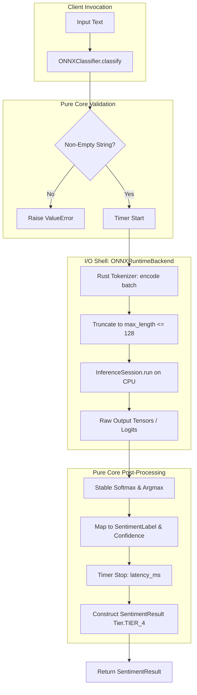

# Architecture & Technical Design: Tier 4 Quantized ONNX & SetFit CPU Runtime

## 1. Architectural Overview & Invariants

Tier 4 introduces high-performance, offline CPU sentiment classification executing in $< 5\text{ms}$ per sample. It decouples the lightweight inference runtime from the heavier offline fine-tuning/quantization pipeline.

### Package & Module Structure
```
src/sentiments/
├── providers/
│   ├── tier4/
│   │   ├── __init__.py          # Exports ONNXClassifier, ONNXRuntimeBackend, MockONNXBackend
│   │   ├── protocol.py          # ONNXBackend Protocol definition
│   │   ├── classifier.py        # ONNXClassifier implementing SentimentClassifier
│   │   ├── engine.py            # ONNXRuntimeBackend (onnxruntime + tokenizers)
│   │   ├── packaging.py         # Model artifact loader & validation
│   │   └── mock.py              # MockONNXBackend for deterministic testing
│   └── tier4.py                 # Backwards-compatibility shim re-exporting tier4 symbols
└── training/                    # Optional training package (requires sentiments[train])
    ├── __init__.py
    └── setfit_pipeline.py       # Sentence transformer fine-tuning & INT8 ONNX exporter
```

### Key Invariants
1. **Zero PyTorch at Runtime**: The inference path (`sentiments.providers.tier4`) MUST NOT import `torch`, `transformers`, or `accelerate`. It depends solely on `onnxruntime`, `tokenizers`, and `numpy`.
2. **Zero Network Calls**: Inference runs 100% locally from disk artifacts. No network sockets or telemetry requests are initiated.
3. **Pure Core Logic**: Input sanitization, probability softmax normalization, argmax selection, and `SentimentResult` construction remain pure Python without external side effects.
4. **Interface Parity**: `ONNXClassifier` implements the canonical `SentimentClassifier` protocol (`classify` and `classify_batch`) returning `Tier.TIER_4`.

---

## 2. Domain Models, State & Interfaces

### Backend Protocol (`protocol.py`)
```python
from typing import Any, Protocol, Sequence
from sentiments.core.models import SentimentLabel

class ONNXBackend(Protocol):
    """Protocol for Tier 4 ONNX inference backends."""

    @property
    def model_name(self) -> str:
        """Identifier of the active model."""
        ...

    def is_available(self) -> bool:
        """Check if backend runtime dependencies and model files are ready."""
        ...

    def predict(self, text: str) -> tuple[SentimentLabel, float, dict[str, Any]]:
        """Run inference on a single text string."""
        ...

    def predict_batch(
        self, texts: Sequence[str]
    ) -> list[tuple[SentimentLabel, float, dict[str, Any]]]:
        """Run vectorized batch inference on multiple texts."""
        ...
```

### Classifier Interface (`classifier.py`)
```python
class ONNXClassifier:
    """Production Tier 4 classifier."""

    def __init__(
        self,
        backend: ONNXBackend | None = None,
        model_path: str | Path | None = None,
    ) -> None:
        ...

    @property
    def tier(self) -> Tier:
        return Tier.TIER_4

    @property
    def model_name(self) -> str:
        return self.backend.model_name

    def classify(self, text: str) -> SentimentResult:
        ...

    def classify_batch(
        self, texts: Sequence[str], fail_fast: bool = False
    ) -> list[SentimentResult]:
        ...
```

### Numerically Stable Softmax
For raw logits vector $z \in \mathbb{R}^K$:
$$p_i = \frac{e^{z_i - \max(z)}}{\sum_{j=1}^K e^{z_j - \max(z)}}$$

---

## 3. Architecture Diagram & Data Flow



---

## 4. Boundary Rules & Performance Budgets

- **Pure Core vs. I/O Shell**:
  - `packaging.py` and `engine.py` manage the I/O boundary (loading `.onnx` model graphs, instantiating `onnxruntime.InferenceSession`, interacting with the filesystem).
  - `classifier.py` and post-processing math (softmax, argmax, validation) remain pure domain logic.
- **Performance Budgets (matching NFRs)**:
  - Single-sample median latency $p_{50} < 5.0\text{ms}$.
  - Single-sample 95th percentile latency $p_{95} < 10.0\text{ms}$.
  - Vectorized batch throughput $\ge 150\text{ QPS}$ on batch size 64.
  - Process memory footprint added by runtime $< 120\text{MB}$.

---

## 5. Testing Strategy

1. **BDD Scenarios (`tests/bdd/features/tier4_onnx.feature`)**:
   - Single-sample happy path classification.
   - Vectorized batch classification with order preservation.
   - Input validation (empty string / whitespace rejection).
   - Long review truncation without crashes.
   - Missing model artifact raises `ClassifierProviderError`.
   - Verified zero network requests via socket monkeypatching.
2. **Unit Tests ($\ge 95\%$ Line/Branch Coverage)**:
   - `tests/unit/test_tier4_classifier.py`: Mock backend unit tests, error propagation, fallback handling in `classify_batch`.
   - `tests/unit/test_tier4_packaging.py`: Config validation, label mapping resolution, missing file errors.
   - `tests/unit/test_tier4_engine.py`: Softmax calculations, shape handling, token truncation.
3. **Mutation Testing**:
   - 100% kill score on pure core logic in `classifier.py` and `packaging.py`.

---

## Review Gate
- [ ] **Gate 3 Approval**: Architecture & design reviewed and approved by human before task breakdown.
