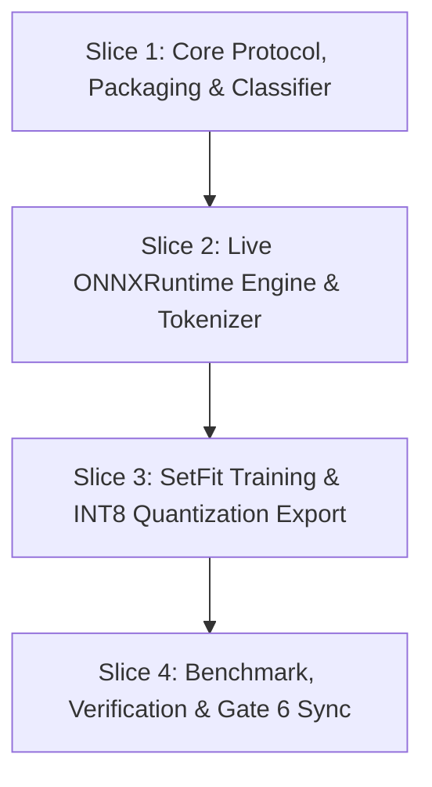

# Task Breakdown: Tier 4 Quantized ONNX & SetFit CPU Runtime

**Feature Branch**: `feat/03-tier4-onnx-runtime`

## 1. Dependency DAG

## 2. Multi-Agent Worktree Streams

| Stream | Worktree Path | Branch | Prerequisite |
| :--- | :--- | :--- | :--- |
| **Core** | *(Main feature worktree)* | `feat/03-tier4-onnx-runtime` | — |
| **Stream A (Runtime Engine)** | `.worktrees/03-onnx-engine` | `feat/03/onnx-engine` | Slice 1 |
| **Stream B (SetFit Pipeline)** | `.worktrees/03-setfit-pipeline` | `feat/03/setfit-pipeline` | Slice 1 |

---

## 3. Vertical Slice Execution Order

### Slice 1: Core Protocol, Packaging & Classifier (Pure Core + Mock Backend)
- [ ] 1.1 **BDD (Step 5.1-A)**: Write Gherkin scenarios in `tests/bdd/features/tier4_onnx.feature` covering single/batch prediction, validation, edge cases, and 0 network enforcement.
- [ ] 1.2 **Review Gate 5.1**: Human sign-off on BDD scenarios.
- [ ] 1.3 **Unit Tests (Red)**: Write unit tests in `tests/unit/test_tier4_classifier.py` and `tests/unit/test_tier4_packaging.py`.
- [ ] 1.4 **Implementation (Green)**: Implement `protocol.py`, `packaging.py`, `mock.py`, and `classifier.py` in `src/sentiments/providers/tier4/` with re-exports in `tier4.py`.
- [ ] 1.5 **Mutation Testing ($100\%$ Kill)**: Run mutmut on `src/sentiments/providers/tier4/` core modules and eliminate all surviving mutants.

### Slice 2: Live ONNXRuntime Engine & Fast Tokenizer
- [ ] 2.1 **Unit Tests (Red)**: Write tests in `tests/unit/test_tier4_engine.py` for `ONNXRuntimeBackend` covering tokenization, truncation, softmax probability distribution, and vectorized batch inference.
- [ ] 2.2 **Implementation (Green)**: Implement `ONNXRuntimeBackend` in `src/sentiments/providers/tier4/engine.py` using `onnxruntime` and `tokenizers`.
- [ ] 2.3 **Coverage Verification**: Ensure $\ge 95\%$ line and branch coverage across engine and packaging.

### Slice 3: SetFit Training & INT8 Quantization Export Pipeline
- [ ] 3.1 **SetFit Fine-Tuning Pipeline**: Implement `src/sentiments/training/setfit_pipeline.py` to train a sentence transformer on `StratifiedSplitter` training set and export INT8 ONNX bundle.
- [ ] 3.2 **Model Export Validation**: Verify exported INT8 ONNX model bundle loads into `ONNXRuntimeBackend` offline.
- [ ] 3.3 **Benchmark Script**: Implement `scripts/benchmark_tier4.py` measuring latency ($p_{50}$, $p_{95}$), QPS, memory footprint, and Macro F1 on the 137 test samples.

### Slice 4: Integration, Verification & Gate 6 Checklist
- [ ] 4.1 **Full Test Suite**: Verify all 180+ tests pass with zero warnings or regressions.
- [ ] 4.2 **SLA Verification**: Verify $p_{50} < 5\text{ms}$ CPU latency and Macro F1 $> 0.85$.
- [ ] 4.3 **Living Spec Sync**: Update `specs/living/sentiment-engine/spec.md` with Tier 4 specifications.
- [ ] 4.4 **Gate 6 Archival**: Archive feature artifacts into `specs/archive/03-tier4-onnx-runtime/`.

---

## Review Gates
- [ ] **Gate 4 Approval**: Tasks breakdown approved by human before writing test code.
- [ ] **Gate 6 Approval**: Final sync and archive sign-off.
