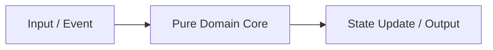

# Architecture & Technical Design: <Feature Title>

## 1. Architectural Overview & Invariants

<High-level summary of how this feature fits into the system without unnecessary dependencies.>

### Key Invariants
1. **<Invariant 1>**: <e.g., Pure domain core with zero I/O dependencies>
2. **<Invariant 2>**: <e.g., Bounds/state validity guarantee>

---

## 2. Domain Models, State & Interfaces

```text
<Data structures, type signatures, traits/protocols, and state transitions>
```

---

## 3. Architecture Diagram & Data Flow



---

## 4. Boundary Rules & Concurrency / Performance Budgets

- **Pure Core vs. I/O Shell**: <Which modules remain pure and how side effects are isolated>
- **Performance & Concurrency Invariants**: <Hot-path latency budgets, main-loop protection, or Tier 0 baseline rules>

---

## 5. Testing Strategy

1. **BDD Scenarios**: <Gherkin feature coverage plan>
2. **Unit Tests ($\ge 95\%$ Coverage)**: <Target modules and edge cases>
3. **Mutation Testing ($100\%$ Kill Score)**: <Core modules targeted for mutation verification>

---

## Review Gate
- [ ] **Gate 3 Approval**: Architecture & design reviewed and approved by human before task breakdown.
