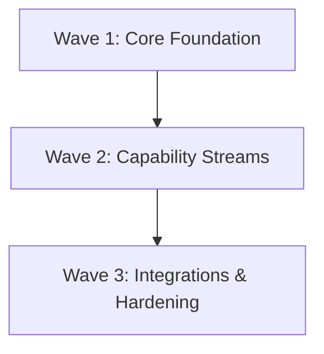

# <Project Name> Roadmap

Baseline: `main` · Status: Active

---

## 1. Dependency Spine & Waves

---

## 2. Work Items & Backlog

Status Legend (changed only on `main` via `chore/roadmap-<id>` branches; see `specs/WORKFLOW.md` §2):
- `⬜ Planned`: Scheduled for execution.
- `🔬 In Research (Gate 0)`: Actively investigating technical feasibility and options.
- `🚀 In Progress (Gates 1–6)`: Gate 0 Go decision made; feature branch / worktree streams active.
- `✅ Shipped`: Verified, merged, living specs synced, archived.
- `❌ Dropped`: Discarded at Gate 0; rationale here, research in `specs/archive/<id>-<slug>/`.

Feature branch & dir naming: ID lowercased, e.g. `W1.2` → `feat/w1.2-data-ingestion`, `specs/features/w1.2-data-ingestion/`.

### Wave 1: Core Foundation

| ID | Item | Effort | Depends on | Status | Spec / Feature Dir | Notes |
| :--- | :--- | :--- | :--- | :--- | :--- | :--- |
| **W1.1** | Core Domain Models | S | — | ⬜ | `specs/features/w1.1-core-models` | Contract lock for downstream streams |
| **W1.2** | Data Ingestion | M | W1.1 | ⬜ | `specs/features/w1.2-data-ingestion` | Requires W1.1 domain contracts |

### Wave 2: Capability Streams

| ID | Item | Effort | Depends on | Status | Spec / Feature Dir | Notes |
| :--- | :--- | :--- | :--- | :--- | :--- | :--- |
| **W2.1** | Stream A: Processing Engine | L | W1.2 | ⬜ | `specs/features/w2.1-processing-engine` | Can run in parallel worktree with W2.2 |
| **W2.2** | Stream B: Reporting / Export | M | W1.2 | ⬜ | `specs/features/w2.2-reporting` | Orthogonal to W2.1 |

---

## 3. Wave Exit Criteria

### Wave 1 Exit Criteria
- [ ] All W1 items marked `✅ Shipped`.
- [ ] Core contracts verified with $\ge 95\%$ test coverage and $100\%$ mutation kill score.
- [ ] Living specs established in `specs/living/`.

### Wave 2 Exit Criteria
- [ ] All W2 items marked `✅ Shipped`.
- [ ] End-to-end BDD scenarios pass across combined streams.
- [ ] No regression against Wave 1 baselines.
