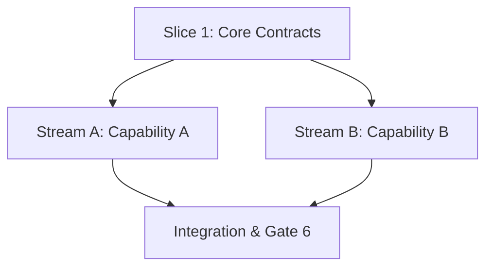

# Task Breakdown: <Feature Title>

**Feature Branch**: `feat/<feature-id>-<feature-name>`

## 1. Dependency DAG

## 2. Multi-Agent Worktree Streams

| Stream | Worktree Path | Branch | Prerequisite |
| :--- | :--- | :--- | :--- |
| **Core** | *(Main feature worktree)* | `feat/<id>-<name>` | — |
| **Stream A** | `.worktrees/<id>-stream-a` | `feat/<id>/stream-a` | Slice 1 |
| **Stream B** | `.worktrees/<id>-stream-b` | `feat/<id>/stream-b` | Slice 1 |

---

## 3. Vertical Slice Execution Order

### Slice 1: <Slice Name>
- [ ] 1.1 **BDD (Step 5.1-A)**: Write Gherkin scenarios covering `REQ-*` and boundary cases.
- [ ] 1.2 **Review Gate 5.1**: Human sign-off on BDD scenarios.
- [ ] 1.3 **Unit Tests (Red)**: Write failing unit tests covering all branches.
- [ ] 1.4 **Implementation (Green)**: Implement minimal production code ($\ge 95\%$ line/branch coverage).
- [ ] 1.5 **Mutation Testing ($100\%$ Kill)**: Run mutation suite and eliminate all surviving mutants.

### Slice 2 [Stream A]: <Slice Name> (`.worktrees/<id>-stream-a`)
- [ ] 2.1 **BDD (Step 5.2-A)**: Write Gherkin scenarios.
- [ ] 2.2 **Review Gate 5.2**: Human sign-off on BDD scenarios.
- [ ] 2.3 **Unit Tests (Red)**: Write failing unit tests.
- [ ] 2.4 **Implementation (Green)**: Implement minimal production code ($\ge 95\%$ coverage).
- [ ] 2.5 **Mutation Testing ($100\%$ Kill)**: Verify $100\%$ mutation kill score.

---

## 4. Integration, Rebase & Gate 6 Checklist

- [ ] Merge completed stream worktrees (rebase onto feature branch, re-verify, `git merge --ff-only`), remove worktrees, and prune (`git worktree prune`). Verify `git worktree list` shows only the repository root.
- [ ] Full test suite passes with $\ge 95\%$ line and branch coverage.
- [ ] Full mutation suite achieves $100\%$ kill score on core logic.
- [ ] Sync delta specs into `specs/living/`.
- [ ] **Gate 4 Approval**: Tasks breakdown approved by human before writing test code.
- [ ] **Gate 6 Approval**: Final sync and archive sign-off.
