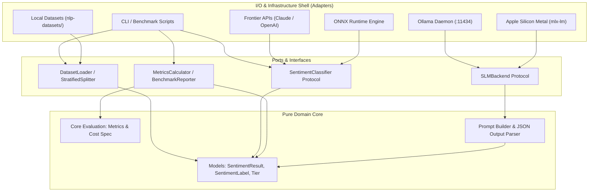
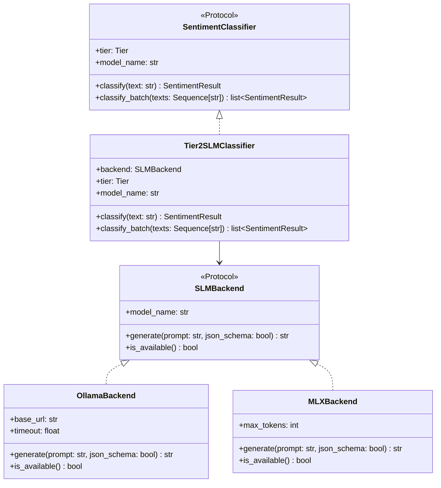
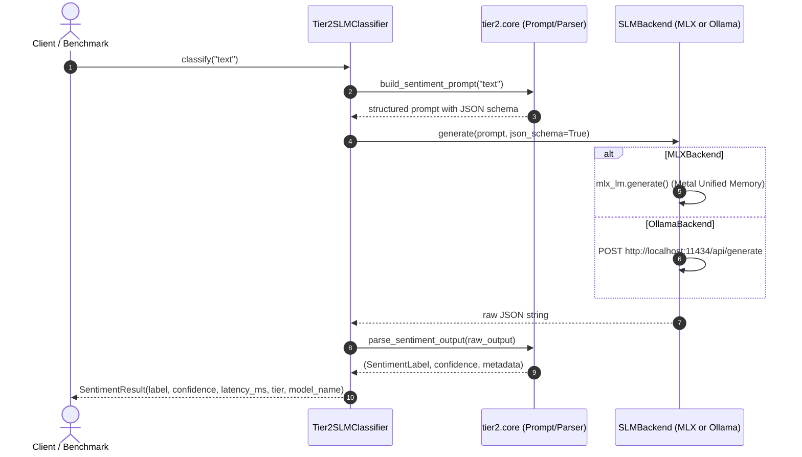

# System Architecture

`sentiments` follows a strict **Hexagonal Architecture (Ports and Adapters)** pattern. The design isolates domain logic, metric evaluations, and data models from external dependencies, model weight runtimes, network daemons, and storage systems.

---

## Hexagonal Core vs I/O Shell

---

## Pure Domain Core

Located under [`src/sentiments/core/`](file:///Users/mmetawea/Workbench/sentiments/src/sentiments/core):
- **[`models.py`](file:///Users/mmetawea/Workbench/sentiments/src/sentiments/core/models.py)**: Immutable value objects:
  - [`SentimentLabel`](file:///Users/mmetawea/Workbench/sentiments/src/sentiments/core/models.py#L6-L9): `POSITIVE`, `NEGATIVE`, `NEUTRAL`.
  - [`Tier`](file:///Users/mmetawea/Workbench/sentiments/src/sentiments/core/models.py#L12-L17): Enumeration of tiers `TIER_0` through `TIER_4`.
  - [`SentimentResult`](file:///Users/mmetawea/Workbench/sentiments/src/sentiments/core/models.py#L20-L36): Frozen dataclass enforcing validation invariants (`confidence` $\in [0, 1]$, `latency_ms` $\ge 0$, non-empty `model_name`).
- **[`classifier.py`](file:///Users/mmetawea/Workbench/sentiments/src/sentiments/core/classifier.py)**: Runtime-checkable [`SentimentClassifier`](file:///Users/mmetawea/Workbench/sentiments/src/sentiments/core/classifier.py#L7-L25) protocol:
  - `tier -> Tier`
  - `model_name -> str`
  - `classify(text: str) -> SentimentResult`
  - `classify_batch(texts: list[str]) -> list[SentimentResult]`

Core domain classes have **zero dependencies** outside the Python standard library.

---

## Provider Architecture & Tier 2 SLM Engine

Tier 2 provides pluggable backends via [`SLMBackend`](file:///Users/mmetawea/Workbench/sentiments/src/sentiments/providers/tier2/protocol.py#L4-L13) protocol:

### Execution Flow: Tier 2 Classification

